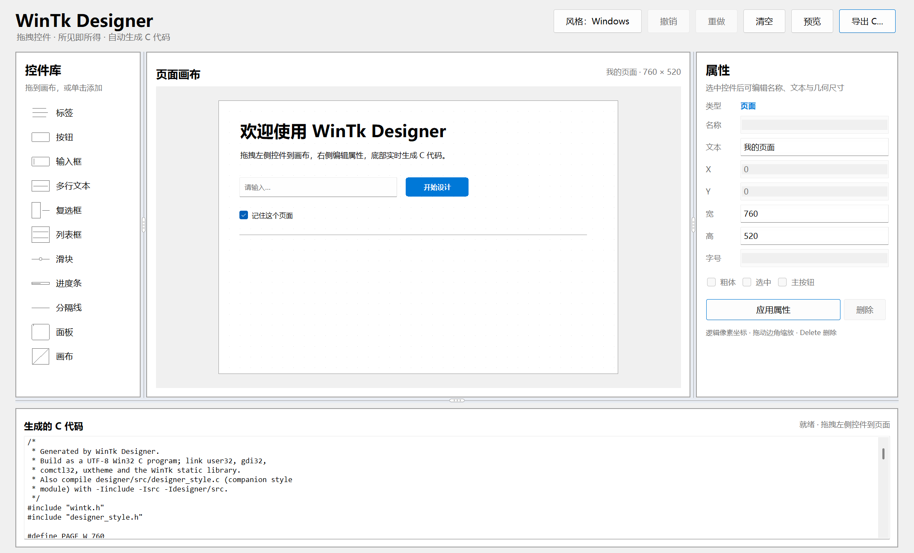

# WinTk Designer

一个用 WinTk 自身实现的轻量级可视化 C UI 页面编辑器，作为 WinTk 仓库的独立子项目维护。



## 功能

- 11 种控件：标签、按钮、输入框、多行文本、复选框、列表框、滑块、进度条、分隔线、面板、画布。
- 从控件库拖到画布，或单击添加；支持选择、移动和 8 个方向的边角缩放。
- 拖动时根据命中区域切换光标：移动为四向箭头，边角为斜向缩放，左右/上下为对应缩放光标；属性输入框和代码区显示文本 I 型光标。
- 左侧控件库、右侧属性面板、底部代码面板均可通过分隔条调整大小。
- 属性编辑：变量名、文本、X/Y/宽/高、字号、粗体、复选框选中态、主按钮样式。
- 8px 网格吸附；方向键微调，`Shift+方向键` 按网格移动，`Delete` 删除，`Esc` 取消选择。
- `Ctrl+Z` / `Ctrl+Y` 撤销/重做；顶部按钮同样可用。
- 风格菜单可在 Windows 原生、Fusion、WinTk 之间切换；画布预览、属性控件和运行时预览同步刷新。
- Designer 自带 `src/designer_style.c`，通过核心 `WtkStylePainter` 接口绘制 Native/Fusion；WinTk 直接使用核心 GDI。
- 实时预览窗口使用真实 WinTk 控件；导出一个完整、可编译的 `.c` 文件，包含 `build_page()`、`WinMain()`，并保留当前选择的应用风格。
- 生成的代码使用 `wtk_place` 绝对布局，页面已设置白色背景；控件事件由开发者继续通过 `wtk_bind` 添加。

## 独立构建

单独构建 Designer（会一并编译一份框架源码，不依赖根目录已有产物）：

```bat
mingw32-make -C designer
designer\build\wintk_designer.exe
```

或只用 CMake：

```bat
cmake -S designer -B designer\build-cmake -G "MinGW Makefiles" -DCMAKE_BUILD_TYPE=Release
cmake --build designer\build-cmake -j
designer\build-cmake\bin\wintk_designer.exe
```

从仓库根目录构建时，CMake 会通过 `add_subdirectory(designer)` 构建它；根 Makefile 的 `designer` 目标会调用这个子项目的 Makefile。

## 操作

1. 从左侧拖入控件，或单击控件库在页面中央添加。
2. 在画布上拖动控件移动；拖动选中框的 8 个控制点缩放。
3. 在右侧修改属性，按 Enter 或点击“应用属性”。
4. 点击页面空白处编辑页面标题和尺寸。
5. 使用“预览”检查真实控件效果，“导出 C...”保存源码。

## 运行时风格

核心 WinTk 默认使用原始 GDI 自绘。Designer 在启动时安装自己的风格 painter：

- `Windows 原生`：`designer_style.c` 实现 UxTheme 原生外观
- `Fusion`：`designer_style.c` 实现中性灰 Qt Fusion 方向外观
- `WinTk`：不注册 painter，直接使用核心 GDI 外观

启动前可通过兼容提示选择初始风格：

```bat
set WINTK_STYLE=native
designer\build\wintk_designer.exe
```

可选提示为 `auto`、`native`、`fusion`（或 `qt`）、`wintk`。没有安装 painter 的普通 WinTk 程序只会使用核心 GDI。

导出 `.c` 时会调用 `designer_style_apply()`；需要把 `designer/src/designer_style.c` 作为伴生模块一起编译：

```bat
gcc -std=c11 -DUNICODE -D_UNICODE ^
    -Iinclude -Isrc -Idesigner/src ^
    page.c designer\src\designer_style.c build\libwintk.a ^
    -o page.exe -mwindows -luser32 -lgdi32 -lcomctl32 -luxtheme
```

## 当前限制

- 没有独立工程文件保存/打开功能；导出的 C 文件就是交付物。
- 控件库暂不含单选组，面板不提供嵌套容器语义。
- 生成代码中的事件处理需要继续手写。
