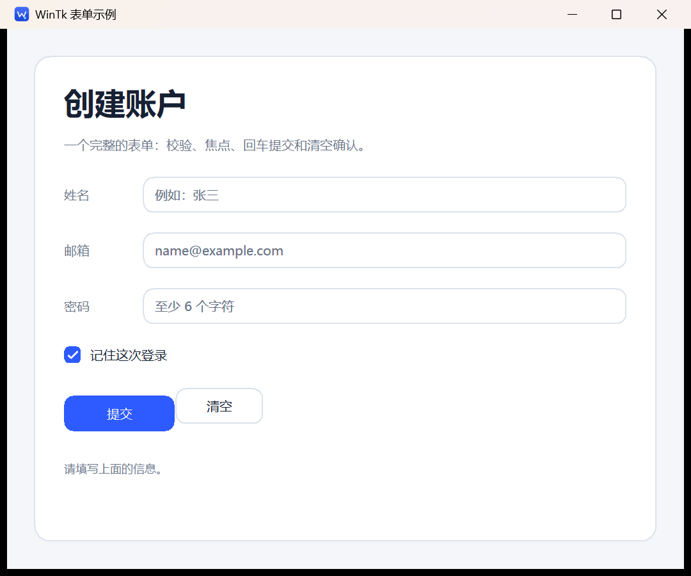
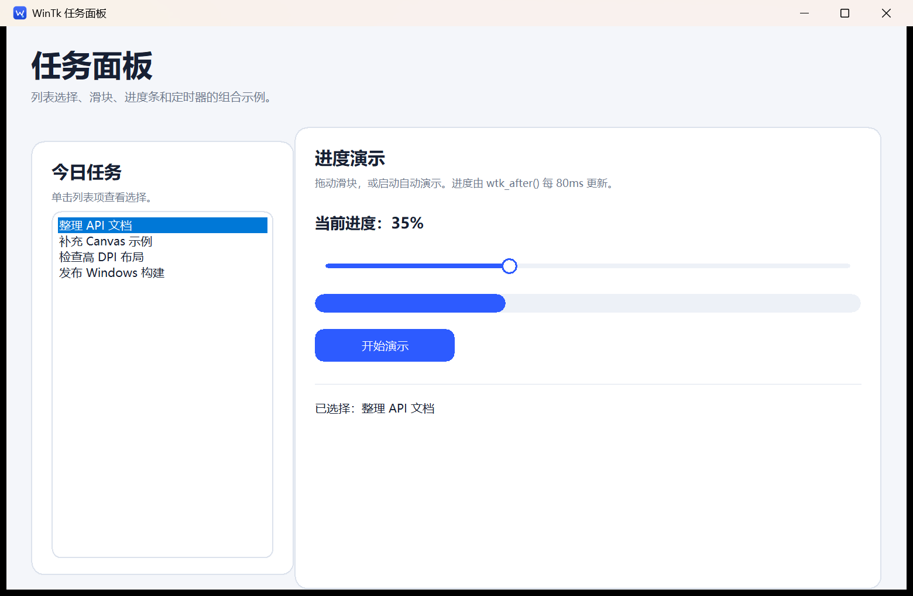
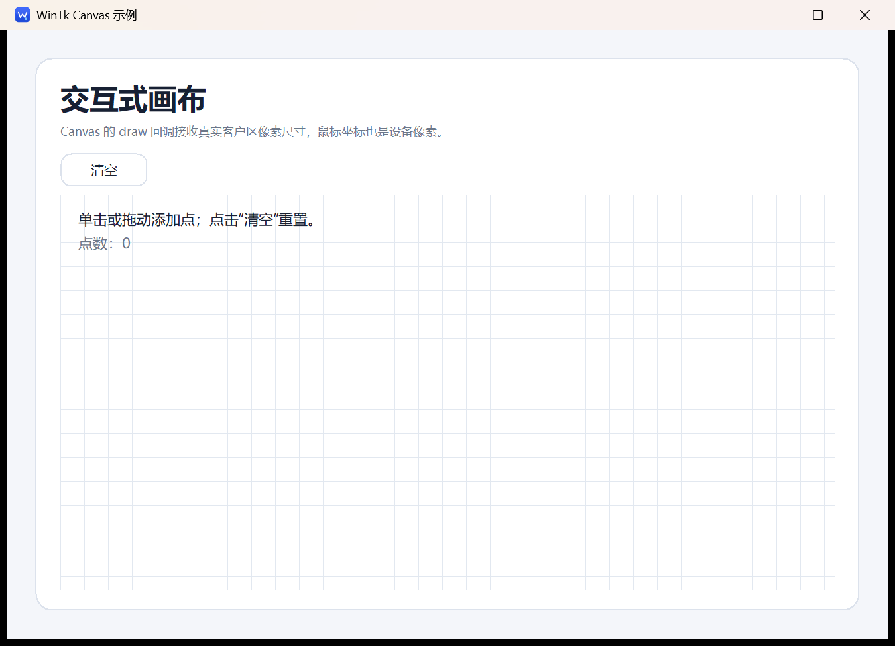
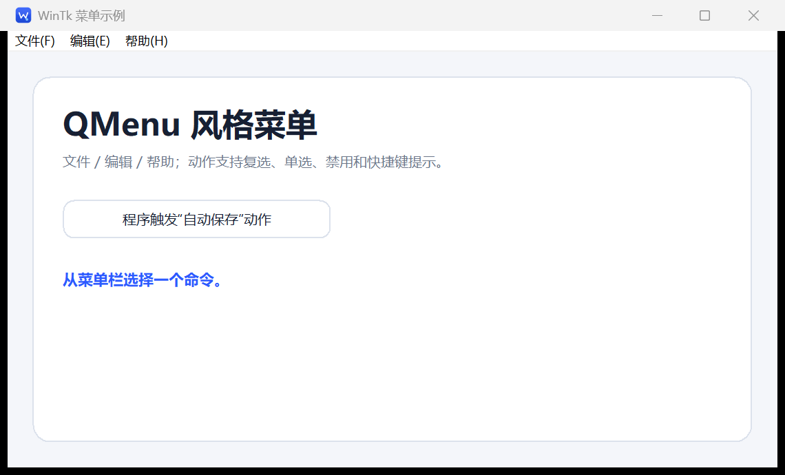

# WinTk / CWtk 示例

这些示例都是完整程序，源码在 `examples/`，可以直接构建运行。它们覆盖常用 API，而不是只展示单个函数。

| 示例 | 源码 | 主要知识点 |
|---|---|---|
| 最小窗口 | [hello.c](../examples/hello.c) | `wtk_app_new`、窗口、标签、输入框、按钮、菜单、事件 |
| 表单 | [form.c](../examples/form.c) | 布局、输入校验、密码框、复选框、焦点、消息框 |
| 任务面板 | [dashboard.c](../examples/dashboard.c) | 列表、滑块、进度条、定时器、状态同步 |
| 交互画布 | [canvas.c](../examples/canvas.c) | Canvas 绘制、鼠标事件、GDI、坐标归一化 |
| QMenu 菜单 | [menu.c](../examples/menu.c) | 菜单栏、子菜单、动作、复选、单选、快捷键 |
| Designer 导出 | 由 Designer 生成 | `wtk_place`、伴生风格模块、构建命令 |

构建全部示例：

```bat
mingw32-make
build\hello.exe
build\form.exe
build\dashboard.exe
build\canvas.exe
build\menu.exe
```

也可以单独构建：

```bat
mingw32-make form
mingw32-make dashboard
mingw32-make canvas
mingw32-make menu
```

CMake 构建后程序位于 `build-cmake\bin\`。

---

## 1. 最小窗口

一个 WinTk 程序的主干只有四步：

1. `wtk_app_new()` 创建应用；
2. `wtk_window()` 创建窗口；
3. 创建控件并用 `wtk_pack()` 布局；
4. `wtk_run()` 进入消息循环，退出后 `wtk_app_free()`。

```c
#include "wintk.h"

static void on_greet(WtkWidget *button, WtkEvent *event, void *data)
{
    WtkWidget *label = (WtkWidget *)data;
    (void)button;
    (void)event;
    wtk_label_set_text(label, "你好，WinTk！");
}

int WINAPI WinMain(HINSTANCE instance, HINSTANCE previous,
                   LPSTR command_line, int show_command)
{
    WtkApp *app = wtk_app_new();
    WtkWidget *window;
    WtkWidget *label;
    WtkWidget *button;

    (void)instance;
    (void)previous;
    (void)command_line;
    (void)show_command;

    window = wtk_window(app, "最小示例", 520, 300);
    label = wtk_label(window, "点击下面的按钮");
    wtk_widget_set_font(label, NULL, 18, WTK_FONT_BOLD);
    wtk_pack(label, WTK_SIDE_TOP, WTK_FILL_X, 0, 24, 24);

    button = wtk_button(window, "打个招呼");
    wtk_button_set_style(button, WTK_BUTTON_PRIMARY);
    wtk_pack(button, WTK_SIDE_TOP, WTK_FILL_NONE, 0, 24, 8);
    wtk_bind(button, WTK_EVENT_CLICK, on_greet, label);

    wtk_window_center(window);
    wtk_run(app);
    wtk_app_free(app);
    return 0;
}
```

`wtk_pack(widget, side, fill, expand, padx, pady)` 的 `side` 决定它贴到父容器的哪一边。`expand=1` 时，剩余空间会分给该控件。

`hello.c` 在此基础上增加了：

- 卡片式背景和圆角边框；
- 中文占位符；
- 输入框按 Enter 提交；
- 原生菜单栏；
- 中文消息框。

完整代码：[examples/hello.c](../examples/hello.c)。

---

## 2. 表单：输入校验和状态



表单示例把输入框、密码框、复选框和状态提示组织成一张卡片。关键点是**把控件指针放进状态结构体**，事件回调通过 `userdata` 取回这些指针。

```c
typedef struct FormState {
    WtkWidget *window;
    WtkWidget *name;
    WtkWidget *email;
    WtkWidget *password;
    WtkWidget *remember;
    WtkWidget *status;
} FormState;
```

创建控件：

```c
add_field(card, "姓名", &state.name, theme);
wtk_entry_set_placeholder(state.name, "例如：张三");

add_field(card, "密码", &state.password, theme);
wtk_entry_set_password(state.password, 1);   /* 密码模式 */
wtk_entry_set_placeholder(state.password, "至少 6 个字符");

state.remember = wtk_checkbox(card, "记住这次登录", 1);
```

`add_field()` 在行容器上创建 `entry`，而不是先创建到 `card` 再 pack 到行里：

```c
WtkWidget *row = wtk_frame(parent);
WtkWidget *label = wtk_label(row, caption);
WtkWidget *field = wtk_entry(row);   /* 父容器必须是 row */
```

WinTk 控件在构造时绑定父容器，`wtk_pack()` 只设置布局参数，不会把控件重新挂到另一个父容器。

校验逻辑在按钮回调里：

```c
static void submit_form(WtkWidget *widget, WtkEvent *event, void *userdata)
{
    FormState *state = userdata;
    const WtkTheme *theme = wtk_app_get_theme(wtk_widget_app(widget));
    const char *name = wtk_entry_get_text(state->name);
    const char *email = wtk_entry_get_text(state->email);

    if (!name || !name[0]) {
        wtk_label_set_text(state->status, "请先填写姓名。");
        wtk_widget_set_foreground(state->status, theme->danger);
        wtk_widget_focus(state->name);
        return;
    }
    if (!email || strchr(email, '@') == NULL) {
        wtk_label_set_text(state->status, "邮箱地址需要包含 @。");
        wtk_widget_set_foreground(state->status, theme->danger);
        wtk_widget_focus(state->email);
        return;
    }

    wtk_label_set_text(state->status, "表单验证通过。");
    wtk_widget_set_foreground(state->status, theme->success);
}
```

同一个回调同时绑定按钮点击和输入框回车：

```c
wtk_bind(submit, WTK_EVENT_CLICK, submit_form, &state);
wtk_bind(state.name, WTK_EVENT_SUBMIT, submit_form, &state);
wtk_bind(state.email, WTK_EVENT_SUBMIT, submit_form, &state);
wtk_bind(state.password, WTK_EVENT_SUBMIT, submit_form, &state);
```

“清空”按钮使用原生确认框：

```c
if (!wtk_ask_yes_no(state->window, "清空表单", "确定要清空所有输入吗？"))
    return;
```

完整代码：[examples/form.c](../examples/form.c)。

---

## 3. 任务面板：列表、滑块、进度条和定时器



这个示例演示控件之间如何同步状态：

- 列表选择 → 更新标签；
- 滑块变化 → 更新进度条；
- 定时器动画 → 同时更新滑块、进度条和文字；
- 关闭窗口 → 取消定时器。

状态结构：

```c
typedef struct DashboardState {
    WtkWidget *window;
    WtkWidget *slider;
    WtkWidget *progress;
    WtkWidget *value_label;
    WtkWidget *selection_label;
    WtkWidget *start_button;
    unsigned timer;
} DashboardState;
```

列表项和选择事件：

```c
list = wtk_listbox(left);
wtk_listbox_add(list, "整理 API 文档");
wtk_listbox_add(list, "补充 Canvas 示例");
wtk_listbox_select(list, 0);
wtk_bind(list, WTK_EVENT_CHANGE, on_list_change, &state);
```

```c
static void on_list_change(WtkWidget *list, WtkEvent *event, void *data)
{
    DashboardState *state = data;
    int index = wtk_listbox_get_selection(list);
    const char *item = wtk_listbox_get_item(list, index);
    char text[256];
    (void)event;
    snprintf(text, sizeof(text), "已选择：%s", item ? item : "");
    wtk_label_set_text(state->selection_label, text);
}
```

滑块更新进度：

```c
static void on_slider_change(WtkWidget *widget, WtkEvent *event, void *data)
{
    DashboardState *state = data;
    int value = wtk_slider_get(state->slider);
    (void)widget;
    (void)event;
    wtk_progress_set(state->progress, value / 100.0);
}
```

定时器使用 `wtk_after()`。它是一次性的，所以在回调末尾重新注册：

```c
static void animation_tick(WtkApp *app, void *data)
{
    DashboardState *state = data;
    int value = wtk_slider_get(state->slider) + 2;

    state->timer = 0;
    if (value > 100)
        value = 0;
    wtk_slider_set(state->slider, value);
    wtk_progress_set(state->progress, value / 100.0);
    state->timer = wtk_after(app, 80, animation_tick, state);
}
```

关闭时必须取消：

```c
static void on_close(WtkWidget *window, WtkEvent *event, void *data)
{
    DashboardState *state = data;
    (void)window;
    (void)event;
    if (state->timer) {
        wtk_cancel_timer(wtk_widget_app(state->window), state->timer);
        state->timer = 0;
    }
}

wtk_bind(window, WTK_EVENT_CLOSE, on_close, &state);
```

完整代码：[examples/dashboard.c](../examples/dashboard.c)。

---

## 4. 交互画布：自绘和鼠标



Canvas 的绘制回调收到：

- `HDC`：已经开启双缓冲的设备上下文；
- `width` / `height`：当前客户区设备像素尺寸；
- `userdata`：创建时传入的指针。

```c
static void canvas_draw(WtkWidget *canvas, HDC dc, int width, int height,
                        void *userdata)
{
    CanvasState *state = userdata;
    WtkApp *app = wtk_widget_app(canvas);
    const WtkTheme *theme = wtk_app_get_theme(app);

    SetBkMode(dc, TRANSPARENT);
    /* 画网格、折线、圆点、文字…… */
    (void)width;
    (void)height;
    (void)theme;
}
```

创建和注册：

```c
canvas = wtk_canvas(card, 600, 380);
wtk_canvas_set_draw(canvas, canvas_draw, &state);
wtk_bind(canvas, WTK_EVENT_MOUSE_DOWN, on_canvas_down, &state);
wtk_bind(canvas, WTK_EVENT_MOUSE_MOVE, on_canvas_move, &state);
wtk_bind(canvas, WTK_EVENT_MOUSE_UP, on_canvas_up, &state);
```

示例把点保存为**相对坐标**，所以窗口缩放后图形仍按比例显示：

```c
state->xs[state->count] = (double)x / (double)width;
state->ys[state->count] = (double)y / (double)height;
```

绘制时再还原：

```c
line[i].x = (LONG)(state->xs[i] * width);
line[i].y = (LONG)(state->ys[i] * height);
```

Canvas 的坐标和尺寸都是**设备像素**，不是 96 DPI 逻辑单位。需要逻辑像素时用：

```c
int padding = wtk_scale(wtk_widget_app(canvas), 18);
```

GDI 对象用完要恢复并删除，示例里使用 `SelectObject` 保存旧对象，再在绘制结束时还原。

完整代码：[examples/canvas.c](../examples/canvas.c)。

---

## 5. QMenu 风格菜单



源码：[examples/menu.c](../examples/menu.c)

菜单栏、子菜单和动作：

```c
WtkMenu *bar = wtk_menubar(window);
WtkMenu *file = wtk_menu_submenu(bar, "文件(&F)");
WtkMenuAction *save;

save = wtk_menu_add_action(file, "保存(&S)", on_save, &state);
wtk_menu_action_set_shortcut_hint(save, "Ctrl+S");

wtk_menu_add_separator(file);
wtk_menu_add_action(file, "退出(&X)", on_exit, &state);
```

复选和单选：

```c
WtkMenuAction *auto_save =
    wtk_menu_add_check_action(edit, "自动保存(&A)", 1, on_auto_save, &state);
WtkMenuAction *light =
    wtk_menu_add_radio_action(edit, "浅色主题", 1, on_theme, &state);
WtkMenuAction *dark =
    wtk_menu_add_radio_action(edit, "深色主题", 0, on_theme, &state);
```

回调签名是 `WtkMenuActionFn`，动作状态在回调前已经更新：

```c
static void on_auto_save(WtkWidget *window, WtkMenuAction *action, void *data)
{
    MenuState *state = data;
    (void)window;
    wtk_label_set_text(state->status,
                       wtk_menu_action_is_checked(action)
                           ? "已开启自动保存"
                           : "已关闭自动保存");
}
```

运行时修改：

```c
wtk_menu_action_set_enabled(save, 0);
wtk_menu_action_set_text(save, "保存全部");
wtk_menu_action_trigger(auto_save);   /* 等价点击，会切换勾选并回调 */
```

菜单中的 `Ctrl+S` 只是显示提示；实际按键需要：

```c
wtk_app_add_shortcut(app, 'S', WTK_MOD_CONTROL, on_ctrl_s, &state);
```

完整 API 说明见 [API.md 的菜单章节](API.md#5-菜单qmenu-风格)。

---

## 6. 使用 Designer 导出的代码

Designer 导出的 `page.c` 可以直接作为独立程序编译。页面使用 `wtk_place` 绝对布局：

```c
static void build_page(WtkWidget *window)
{
    WtkWidget *title = wtk_label(window, "欢迎使用 WinTk Designer");
    wtk_place(title, 40, 36, 540, 44);
    wtk_widget_set_font(title, NULL, 24, WTK_FONT_BOLD);

    WtkWidget *button = wtk_button(window, "开始设计");
    wtk_button_set_style(button, WTK_BUTTON_PRIMARY);
    wtk_place(button, 356, 146, 120, 38);
}
```

编译 Native/Fusion 风格页面时，需要一起编译伴生模块：

```bat
gcc -std=c11 -DUNICODE -D_UNICODE ^
    -Iinclude -Isrc -Idesigner/styles ^
    page.c designer\styles\designer_style.c build\libwintk.a ^
    -o page.exe -mwindows -luser32 -lgdi32 -lcomctl32 -luxtheme
```

生成的代码会调用：

```c
designer_style_apply(app, DESIGNER_STYLE_NATIVE);
```

纯 WinTk 风格页面不需要 `designer_style.c`。

---

## 常见约定

- 所有公开文本使用 UTF-8；源码文件本身也要保存为 UTF-8。
- 布局尺寸是 96 DPI 逻辑单位；鼠标事件、Canvas 绘制和 `wtk_scale()` 使用设备像素。
- `WtkApp` 拥有所有窗口和控件，退出后不要再访问这些指针。
- 控件在创建时绑定父容器；`wtk_pack()` / `wtk_place()` 不会重新设置父容器。
- 事件回调在 UI 线程执行，不要在里面阻塞等待。
- 定时器必须在关闭时取消，或确保回调在应用销毁前结束。
- 原生 EDIT/LISTBOX 是子窗口，编辑框的鼠标和输入法由 Windows 处理。
- `wtk_pack()` 适合流式布局；需要精确坐标时用 `wtk_place()`，Designer 生成的就是后者。

更多 API 细节见 [API.md](API.md)。
